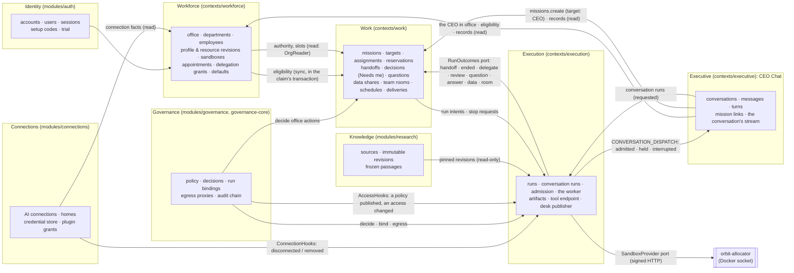
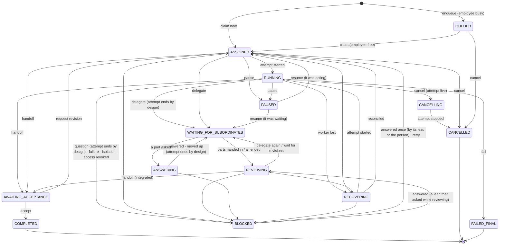
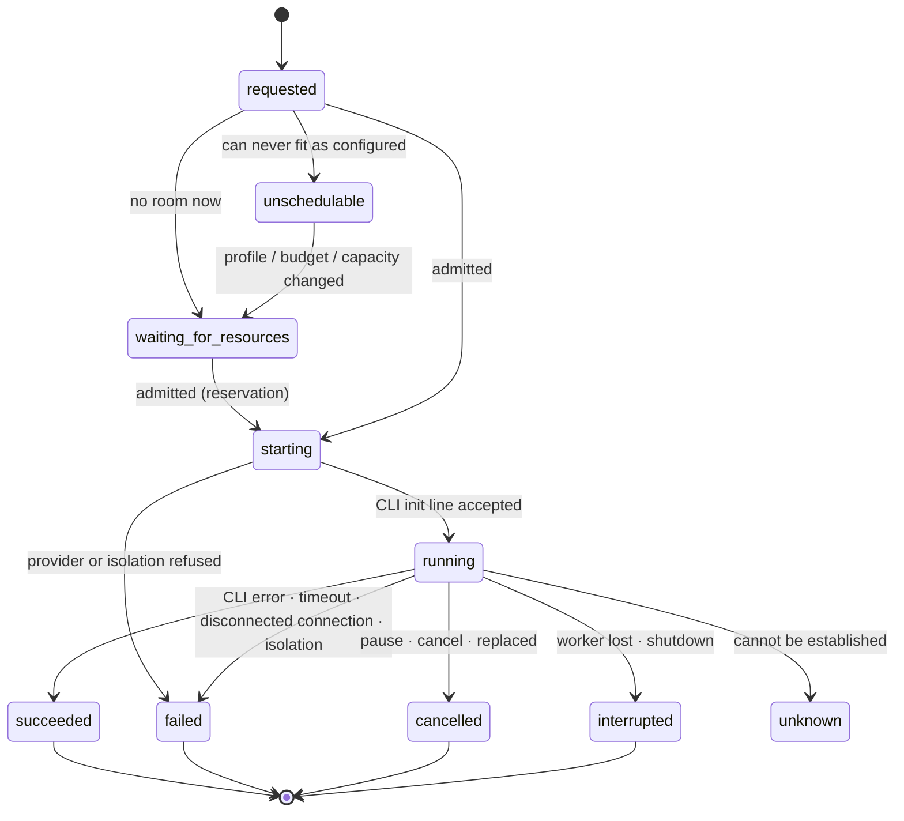
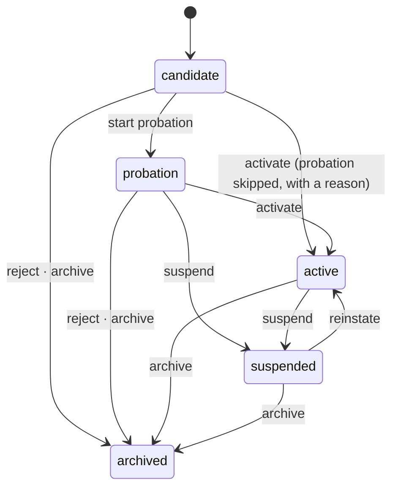

# The Office: contexts, events and states

How Orbit Web's virtual office (ADR 0061) is put together: the bounded contexts and who depends on whom, the durable
events between them, and the state machines each one owns. The code is the reference -- `apps/api/src/contexts/` and
`packages/contracts/src/workforce.ts` -- and this page says where each part lives.

## Context map

- **Shared** (`contexts/shared`): the outbox (`workforce.events`), the per-consumer inbox, idempotency keys, the
  office version and `office.changed` on the app stream. Every table carries `account_id` (the OrbitId).
- **Domain purity**: `contexts/*/domain/` imports no framework, database, file system or HTTP (`boundaries.spec.ts`).
- **Ports**: `SANDBOX_PROVIDER` (container or development `process`), `CONNECTION_SECRETS` (the credential store),
  `RUN_OUTCOMES` (Execution → Work), `CONVERSATION_DISPATCH` (Execution → Executive: a conversation run the pass
  admitted, held or found interrupted).
- **Roles** (`contexts/work/domain/roles.ts`): the CEO, a manager with or without a team, an employee -- from the
  appointment in force and the department's working members. One place feeds what an attempt is told, the tools it is
  offered and the tool door (`AttemptContext.team.denied`, `connectorsDenied`) and whether its hand-in is taken.
- **CEO Chat** (`contexts/executive`, ADR 0062): a conversation is the company's; an answer (a TURN) is a CONVERSATION
  RUN of the CEO in office (`workforce.conversation_runs`), admitted by the same pass as attempts and never at the same
  time as another run of the CEO (both ways); it runs the Claude CLI with no tool in a session sandbox of kind
  `executive`, decided by governance as the employee (run kind `executive`). Quick actions are Orbit's records
  (`executive/domain/records.ts`); a proposal becomes a mission only through `MissionsService.create`.
- **The CEO belongs to no department**: an employee appointed CEO from a department leaves it in the same transaction
  (`EmployeeDepartmentChanged`), a move of the CEO into one is refused (`appointed_ceo`), and the database's
  `appointment_matches()` holds it at commit -- so the CEO's work is the company's: its policy, its room, its defaults.
- **Pure rules of Work** (`contexts/work/domain/`): `authority.ts` (whom a lead may give work to: its appointment in force
  and its grants), `target.ts` (who a mission goes to), `team.ts` (a plan's rules, `leadNext`: review, answer or wait),
  `data-authorization.ts` (what one attempt may read), `assignment.ts` (the state machine). Workforce keeps
  `appointment.ts` and `execution-precedence.ts` (mission > employee > department > company).
- **Synchronous edges** stay inside one transaction (eligibility at a claim, the reservation, the run intent);
  everything else crosses as a durable event or a stop request on the run row.

## Events

Every durable event is a row of `INTEGRATION_EVENTS` (`packages/contracts/src/workforce.ts`), validated against its
schema version when written and when read, written in the transaction of the change that raised it. Consumers record
each event they handled in the inbox (`consumer_inbox`) in the transaction of their effect, so a replay changes nothing.

| event | raised by | handled by |
|---|---|---|
| `OfficeSetUp`, `DepartmentCreated`, `DepartmentChanged`, `DepartmentArchived` | Workforce (office, departments) | the pages (`office.changed`) |
| `EmployeeHired`, `EmployeeProfileRevised`, `EmployeeDepartmentChanged` | Workforce (hiring, an employee's revisions) | the pages |
| `EmployeeEmploymentChanged`, `EmployeeActivated` | Workforce (employment) | `work.scheduler` (queued work may start) |
| `EmployeeResourcesRevised`, `BudgetChanged`, `CapacityChanged` | Workforce, the budget, the capacity probe | the admission pass (pending runs re-read) |
| `SandboxProvisionRequested` | Workforce (hire, a retried provisioning) | the sandbox provisioner (polls `PROVISIONING`, woken by the outbox) |
| `SandboxReady`, `SandboxFailed` | the sandbox provisioner | `work.scheduler` (on ready) |
| `MissionCreated`, `MissionPlanRevised` | Work (a new mission, a team's plan) | the pages |
| `AssignmentQueued`, `AssignmentClaimed` | Work (create, the queue) | `work.scheduler` (on queued) |
| `AssignmentDelegated`, `AssignmentReviewing`, `AssignmentAnswering` | Work (a lead's plan, its review, its team's questions) | the pages |
| `ClarificationRequested`, `ClarificationEscalated` | Work (a question asked, moved up a level) | `work.team` (wakes the lead it is asked of) |
| `ClarificationAnswered`, `ClarificationWithdrawn` | Work (answered once; withdrawn with its asker's end) | the pages |
| `AppointmentChanged`, `DelegationGrantChanged` | Workforce (appointments, grants) | the pages |
| `AssignmentHandedOver` | Work (a person's handover) | `work.scheduler`, `execution.workspace-cleanup` |
| `RunRequested`, `RunStarted`, `RunFinished`, `StaleResultRejected` | Work / Execution | the worker (polls `requested`, woken by the outbox) |
| `ResourcesReserved`, `RunWaitingForResources`, `RunUnschedulable`, `ResourcesReleased` | Execution (admission, release) | the admission pass; the mission's timeline |
| `HandoffSubmitted` | Work (a hand-in) | `work.team` (wakes a waiting lead) |
| `RevisionRequested`, `InformationProvided` | Work (a person's review, an answer) | the worker (a new attempt) |
| `AssignmentAccepted` | Work (a person's or a lead's acceptance) | `execution.desk` (publish to the desk), `work.delivery` (deliveries) |
| `DeskPublished` | Execution (the desk publisher) | `execution.workspace-cleanup` |
| `AssignmentBlocked`, `AssignmentPaused`, `AssignmentResumed` | Work | the pages; Needs me |
| `AssignmentCancelling`, `AssignmentCancelled`, `AssignmentFailed` | Work | `work.team`, `work.cascade` (a lead's open parts end with it; its question is withdrawn), `execution.workspace-cleanup` |
| `EmployeeDepartmentChanged` | Workforce | `execution.access` (an attempt holding another department's room is stopped) |
| `ReservationReleased` | Work (the employee is free) | `work.scheduler` (its next queued work) |
| `ExecutiveMissionLinked` | Executive (a mission given from a CEO Chat conversation) | the mission's timeline ("Given to the CEO from CEO Chat") |
| `HandoffSubmitted`, `AssignmentAccepted`, `AssignmentBlocked`, `AssignmentFailed`, `AssignmentCancelled`, `ClarificationRequested`, `RunUnschedulable` | Work / Execution | also `executive.notices`: one system message in the conversation a mission was given from (its root's end, a question for the owner, work that cannot start) |
| `DecisionRequested`, `DecisionResolved` | Work (Needs me) | the pages |
| `OccurrenceCreated` | Work (a schedule's period) | the pages |
| `DeliveryRequested`, `DeliveryReconciled` | Work (deliveries) | the pages |
| `PluginGrantChanged`, `ConnectionChanged` | Connections | `work.scheduler` (on a connection change) |

## States

### An assignment (Work)

An employee holds one assignment at a time: a reservation row exists exactly while its assignment is in a holding state
(a deferred constraint trigger checks it at commit). Every claim and every new attempt moves the **fence**; a result
from an older fence is refused (`StaleResultRejected`). An attempt ACTS only while its fence is current and its work is
in ASSIGNED, RUNNING, REVIEWING, ANSWERING or RECOVERING: once it delegated, asked or handed in, its tools are closed
and its run is stopped by design (a success, `Ended by design: ...`). Commands name the version they were made against
(If-Match → 412); a review names the handoff digest it read (→ 409); the person reviews a mission's root only, a lead
its parts. Bounds: 5 revisions of one hand-in (`rework_limit`), 3 plans (`replan_limit`), 3 questions
(`question_limit`) per assignment; a lead is woken at most twice for one question before it moves up by itself.

### A question (Work)

A part asks its LEAD; the root asks the person who gave the work (Needs me) -- unless it is a manager, which decides.
`open` → `answered` (a compare-and-set: two answers at once resume the asker exactly once) or `withdrawn` (its asker
ended). Managers and the CEO never move a question up; a lead who leads by a grant may, only to a lead below the CEO.
A question left unanswered after its lead's wakes, or overdue, moves up by itself to a lead below the CEO -- or, where
the next hop would be the CEO or the person, is answered for its asker by `system:clarifications` ("decide with your
best judgment and say what you assumed"). Each hop is appended to its route (`workforce.clarification_routes`, never
changed). The person's answer to a question asked of a lead is refused (409 `asked_of_lead`).

### A conversation run, and a turn (Execution, Executive)

A CONVERSATION RUN (`workforce.conversation_runs`): `requested` → `waiting` (said why: the employee's attempt runs, the
account's budget or the host is in use) → `starting` (admitted: its compute reserved, leased to this process's worker)
→ `running` → `succeeded` | `failed` | `interrupted` | `cancelled`; one that can never start as configured is `failed`
with the numbers. One live per employee (a unique index), and none while an attempt of the employee is live (and the
reverse: the admission pass holds the attempt). Released (`released_at`, the budget's counters) once its process is gone.
A TURN (`executive.turns`) follows it: `queued` (behind the conversation's running answer) → `waiting` → `running` →
`completed` | `failed` (`ceo_changed`, `ceo_unavailable`, `governance`, `unschedulable`, `tool_refused`, `cli_error`) |
`interrupted` (a stop, a restart, a time limit, a connection gone) | `cancelled`; one waiting and one running per
conversation at most, and an owner's message joins the turn that has not started.

### A run, one attempt (Execution)

A run's compute reservation is held from admission until its containers are verified gone; then `ResourcesReleased`
wakes the admission pass. Recovery: a run whose worker is gone is stopped and removed through the provider (verified)
before Work hears it was interrupted, never run a second time.

**What an attempt's file tools reach.** The areas are declared once, `FILE_AREAS` in
`contexts/execution/infrastructure/sandbox/allocator-protocol.ts`:

| area | access | what it holds |
|---|---|---|
| `/work` | read and write | the assignment's working tree, seeded from the desk |
| `/output` | read and write | what is handed in |
| `/input` | read only | what was handed to this attempt: its parts' latest hand-ins for a lead's review (`unit-<key>-<file>`), what its lead shared, the mission's sources |
| `/team` | read and write | the team room |

`/toolbox` is the desk's toolbox inside `/work`.

Every layer reads that declaration:
- the tool door (`tools.service.ts` `pathOf`);
- the allocator and the program it runs in the tool plane, which is handed the declaration as data;
- the development provider;
- the integration tests' double.

A path is held to the area it names, through links too. A refusal is the tool's answer, in its own words. A version a
lead sends back is not in its next `/input`; the part keeps its `/work` and works on; the mission keeps every version.

**What the owner reads of the people's exchanges.** A mission's *Communication* tab shows two things:
- **a pipeline:** who holds which part, and its stage;
- **one thread** (`GET /api/missions/:id/messages`, `work/domain/mission-thread.ts`), built from the records the mission
  already keeps, each message from someone to someone:
  - the work given;
  - questions, their moves and their answers;
  - hand-ins, with their files;
  - reviews, with their notes;
  - Orbit's notices.

### An employee (Workforce)

Availability is separate: `available`, `busy` (holds an assignment) or `ineligible` (with the reason: employment, an
expired assistant, its sandbox not READY, its connection not connected).

### A personal sandbox (Workforce)

`PROVISIONING → READY | FAILED → ARCHIVED`. READY only once its desk, cache and toolbox areas exist with their labels, a
write test passed in each, and each area's enforcement level is recorded with its evidence; no container runs.

### A delivery (Work)

`PENDING_CHANNEL` (no channel yet) · `PENDING → SENDING → SENT` (only with a receipt) · `NEEDS_RECONCILIATION` (it may or
may not have reached its receiver: a person says which) · `FAILED`.
