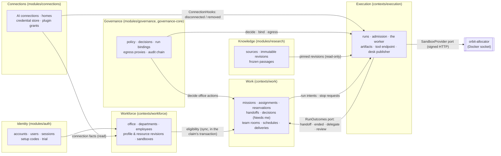
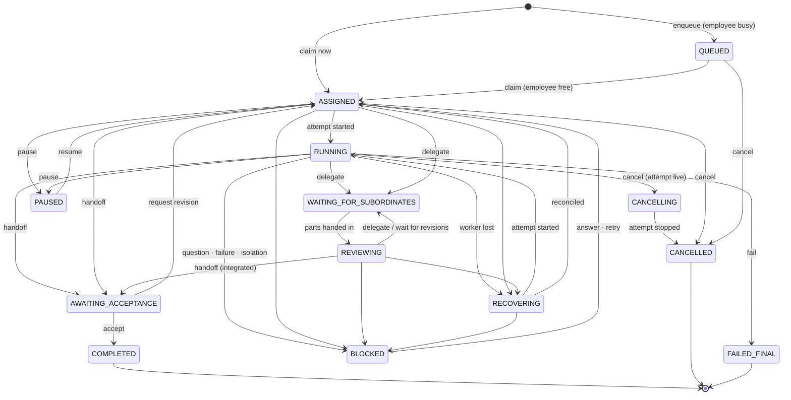
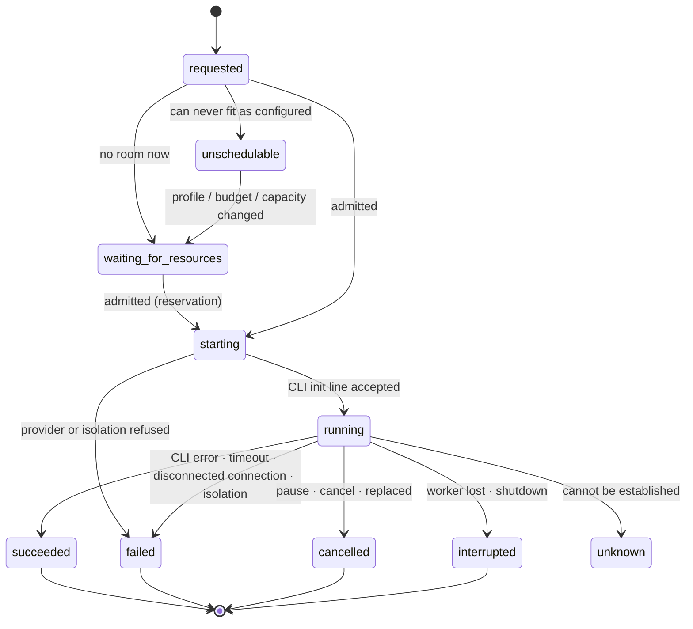
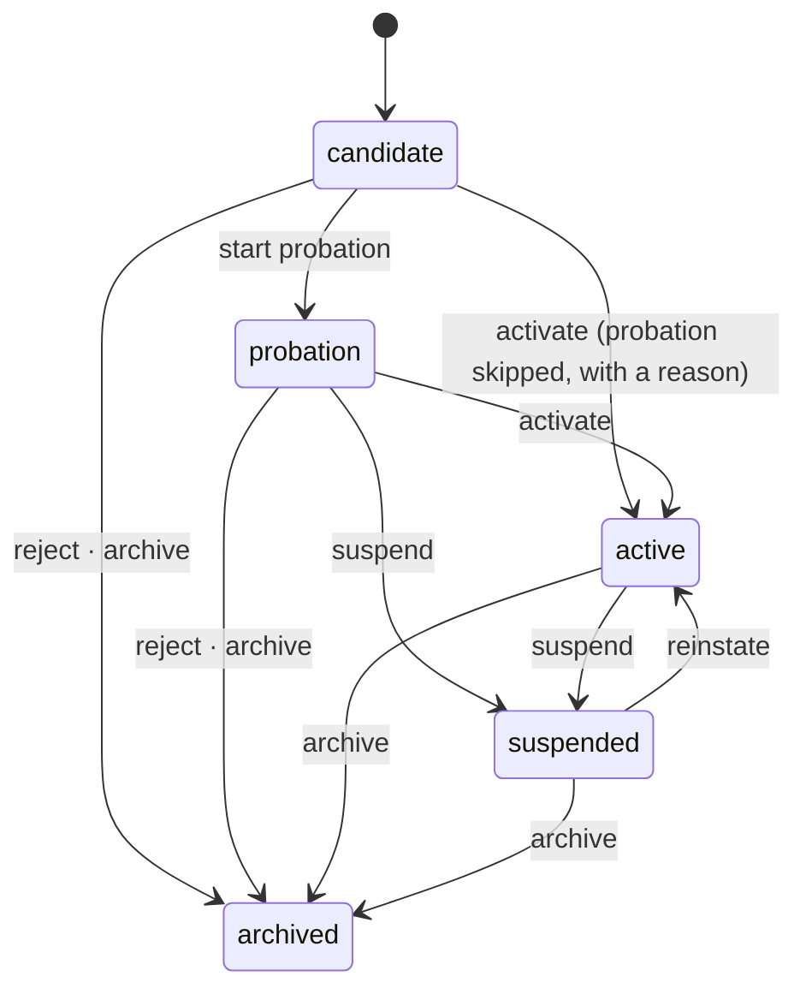

# The Office: contexts, events and states

How Orbit Web's virtual office (ADR 0067) is put together: the bounded contexts and who depends on whom, the durable
events between them, and the state machines each one owns. The code is the reference -- `apps/api/src/contexts/` and
`packages/contracts/src/workforce.ts` -- and this page says where each part lives.

## Context map

- **Shared** (`contexts/shared`): the outbox (`workforce.events`), the per-consumer inbox, idempotency keys, the
  office version and `office.changed` on the app stream. Every table carries `account_id` (the OrbitId).
- **Domain purity**: `contexts/*/domain/` imports no framework, database, file system or HTTP (`boundaries.spec.ts`).
- **Ports**: `SANDBOX_PROVIDER` (container or development `process`), `CONNECTION_SECRETS` (the credential store),
  `RUN_OUTCOMES` (Execution → Work).
- **Synchronous edges** stay inside one transaction (eligibility at a claim, the reservation, the run intent);
  everything else crosses as a durable event or a stop request on the run row.

## Events

Every durable event is a row of `INTEGRATION_EVENTS` (`packages/contracts/src/workforce.ts`), validated against its
schema version when written and when read, written in the transaction of the change that raised it. Consumers record
each event they handled in the inbox (`consumer_inbox`) in the transaction of their effect, so a replay changes nothing.

| event | raised by | handled by |
|---|---|---|
| `OfficeSetUp`, `DepartmentCreated`, `DepartmentChanged`, `DepartmentArchived` | Workforce (office, departments) | the pages (`office.changed`) |
| `EmployeeHired`, `EmployeeProfileRevised`, `EmployeeDepartmentChanged` | Workforce (hiring, an employee's revisions) | the pages |
| `EmployeeEmploymentChanged`, `EmployeeActivated` | Workforce (employment) | `work.scheduler` (queued work may start) |
| `EmployeeResourcesRevised`, `BudgetChanged`, `CapacityChanged` | Workforce, the budget, the capacity probe | the admission pass (pending runs re-read) |
| `SandboxProvisionRequested` | Workforce (hire, a retried provisioning) | the sandbox provisioner (polls `PROVISIONING`, woken by the outbox) |
| `SandboxReady`, `SandboxFailed` | the sandbox provisioner | `work.scheduler` (on ready) |
| `MissionCreated`, `MissionPlanRevised` | Work (a new mission, a team's plan) | the pages |
| `AssignmentQueued`, `AssignmentClaimed` | Work (create, the queue) | `work.scheduler` (on queued) |
| `AssignmentDelegated`, `AssignmentReviewing` | Work (a lead's plan, its review) | the pages |
| `RunRequested`, `RunStarted`, `RunFinished`, `StaleResultRejected` | Work / Execution | the worker (polls `requested`, woken by the outbox) |
| `ResourcesReserved`, `RunWaitingForResources`, `RunUnschedulable`, `ResourcesReleased` | Execution (admission, release) | the admission pass; the mission's timeline |
| `HandoffSubmitted` | Work (a hand-in) | `work.team` (wakes a waiting lead) |
| `RevisionRequested`, `InformationProvided` | Work (a person's review, an answer) | the worker (a new attempt) |
| `AssignmentAccepted` | Work (a person's or a lead's acceptance) | `execution.desk` (publish to the desk), `work.delivery` (deliveries) |
| `DeskPublished` | Execution (the desk publisher) | `execution.workspace-cleanup` |
| `AssignmentBlocked`, `AssignmentPaused`, `AssignmentResumed` | Work | the pages; Needs me |
| `AssignmentCancelling`, `AssignmentCancelled`, `AssignmentFailed` | Work | `work.team`, `execution.workspace-cleanup` |
| `ReservationReleased` | Work (the employee is free) | `work.scheduler` (its next queued work) |
| `DecisionRequested`, `DecisionResolved` | Work (Needs me) | the pages |
| `OccurrenceCreated` | Work (a schedule's period) | the pages |
| `DeliveryRequested`, `DeliveryReconciled` | Work (deliveries) | the pages |
| `PluginGrantChanged`, `ConnectionChanged` | Connections | `work.scheduler` (on a connection change) |

## States

### An assignment (Work)

An employee holds one assignment at a time: a reservation row exists exactly while its assignment is in a holding state
(a deferred constraint trigger checks it at commit). Every claim and every new attempt moves the **fence**; a result
from an older fence is refused (`StaleResultRejected`). Commands name the version they were made against (If-Match →
412); a review names the handoff digest it read (→ 409).

### A run, one attempt (Execution)

A run's compute reservation is held from admission until its containers are verified gone; then `ResourcesReleased`
wakes the admission pass. Recovery: a run whose worker is gone is stopped and removed through the provider (verified)
before Work hears it was interrupted, never run a second time.

### An employee (Workforce)

Availability is separate: `available`, `busy` (holds an assignment) or `ineligible` (with the reason: employment, an
expired assistant, its sandbox not READY, its connection not connected).

### A personal sandbox (Workforce)

`PROVISIONING → READY | FAILED → ARCHIVED`. READY only once its desk, cache and toolbox areas exist with their labels, a
write test passed in each, and each area's enforcement level is recorded with its evidence; no container runs.

### A delivery (Work)

`PENDING_CHANNEL` (no channel yet) · `PENDING → SENDING → SENT` (only with a receipt) · `NEEDS_RECONCILIATION` (it may or
may not have reached its receiver: a person says which) · `FAILED`.
